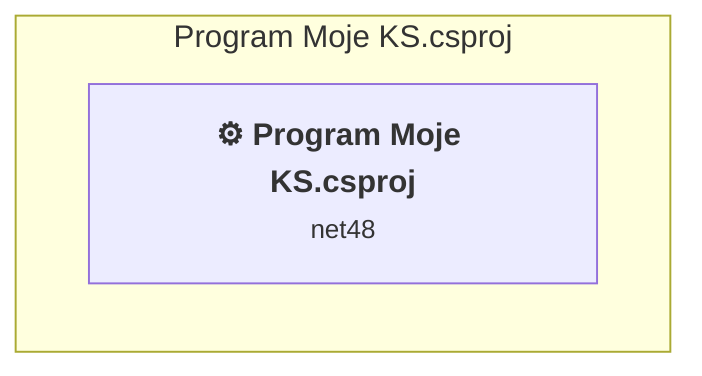

# Projects and dependencies analysis

This document provides a comprehensive overview of the projects and their dependencies in the context of upgrading to .NETCoreApp,Version=v8.0.

## Table of Contents

- [Executive Summary](#executive-Summary)
  - [Highlevel Metrics](#highlevel-metrics)
  - [Projects Compatibility](#projects-compatibility)
  - [Package Compatibility](#package-compatibility)
  - [API Compatibility](#api-compatibility)
  - [Binding Redirect Configuration](#binding-redirect-configuration)
- [Aggregate NuGet packages details](#aggregate-nuget-packages-details)
- [Top API Migration Challenges](#top-api-migration-challenges)
  - [Technologies and Features](#technologies-and-features)
  - [Most Frequent API Issues](#most-frequent-api-issues)
- [Projects Relationship Graph](#projects-relationship-graph)
- [Project Details](#project-details)

  - [Program Moje KS.csproj](#program-moje-kscsproj)

## Executive Summary

### Highlevel Metrics

| Metric | Count | Status |
| :--- | :---: | :--- |
| Total Projects | 1 | All require upgrade |
| Total NuGet Packages | 0 | All compatible |
| Total Code Files | 21 |  |
| Total Code Files with Incidents | 14 |  |
| Total Lines of Code | 10503 |  |
| Total Number of Issues | 4050 |  |
| Estimated LOC to modify | 4048+ | at least 38.5% of codebase |

### Projects Compatibility

| Project | Target Framework | Difficulty | Package Issues | API Issues | Binding Issues | Est. LOC Impact | Description |
| :--- | :---: | :---: | :---: | :---: | :---: | :---: | :--- |
| [Program Moje KS.csproj](#program-moje-kscsproj) | net48 | 🟡 Medium | 0 | 4048 | 0 | 4048+ | ClassicWinForms, Sdk Style = False |

### Package Compatibility

| Status | Count | Percentage |
| :--- | :---: | :---: |
| ✅ Compatible | 0 | 0.0% |
| ⚠️ Incompatible | 0 | 0.0% |
| 🔄 Upgrade Recommended | 0 | 0.0% |
| ***Total NuGet Packages*** | ***0*** | ***100%*** |

### API Compatibility

| Category | Count | Impact |
| :--- | :---: | :--- |
| 🔴 Binary Incompatible | 3614 | High - Require code changes |
| 🟡 Source Incompatible | 434 | Medium - Needs re-compilation and potential conflicting API error fixing |
| 🔵 Behavioral change | 0 | Low - Behavioral changes that may require testing at runtime |
| ✅ Compatible | 7814 |  |
| ***Total APIs Analyzed*** | ***11862*** |  |

## Aggregate NuGet packages details

| Package | Current Version | Suggested Version | Projects | Description |
| :--- | :---: | :---: | :--- | :--- |

## Top API Migration Challenges

### Technologies and Features

| Technology | Issues | Percentage | Migration Path |
| :--- | :---: | :---: | :--- |
| Windows Forms | 3614 | 89.3% | Windows Forms APIs for building Windows desktop applications with traditional Forms-based UI that are available in .NET on Windows. Enable Windows Desktop support: Option 1 (Recommended): Target net9.0-windows; Option 2: Add <UseWindowsDesktop>true</UseWindowsDesktop>; Option 3 (Legacy): Use Microsoft.NET.Sdk.WindowsDesktop SDK. |
| GDI+ / System.Drawing | 432 | 10.7% | System.Drawing APIs for 2D graphics, imaging, and printing that are available via NuGet package System.Drawing.Common. Note: Not recommended for server scenarios due to Windows dependencies; consider cross-platform alternatives like SkiaSharp or ImageSharp for new code. |
| Legacy Configuration System | 2 | 0.0% | Legacy XML-based configuration system (app.config/web.config) that has been replaced by a more flexible configuration model in .NET Core. The old system was rigid and XML-based. Migrate to Microsoft.Extensions.Configuration with JSON/environment variables; use System.Configuration.ConfigurationManager NuGet package as interim bridge if needed. |

### Most Frequent API Issues

| API | Count | Percentage | Category |
| :--- | :---: | :---: | :--- |
| T:System.Windows.Forms.ComboBox | 311 | 7.7% | Binary Incompatible |
| T:System.Windows.Forms.Panel | 309 | 7.6% | Binary Incompatible |
| T:System.Windows.Forms.CheckBox | 301 | 7.4% | Binary Incompatible |
| T:System.Windows.Forms.Label | 194 | 4.8% | Binary Incompatible |
| T:System.Windows.Forms.Control.ControlCollection | 124 | 3.1% | Binary Incompatible |
| P:System.Windows.Forms.Control.Controls | 124 | 3.1% | Binary Incompatible |
| T:System.Windows.Forms.ToolStripMenuItem | 111 | 2.7% | Binary Incompatible |
| P:System.Windows.Forms.Control.Name | 107 | 2.6% | Binary Incompatible |
| P:System.Windows.Forms.Control.Location | 105 | 2.6% | Binary Incompatible |
| T:System.Windows.Forms.GroupBox | 96 | 2.4% | Binary Incompatible |
| M:System.Windows.Forms.Control.ControlCollection.Add(System.Windows.Forms.Control) | 95 | 2.3% | Binary Incompatible |
| P:System.Windows.Forms.Control.TabIndex | 75 | 1.9% | Binary Incompatible |
| P:System.Windows.Forms.Control.Size | 75 | 1.9% | Binary Incompatible |
| T:System.Windows.Forms.Keys | 69 | 1.7% | Binary Incompatible |
| P:System.Windows.Forms.CheckBox.Checked | 68 | 1.7% | Binary Incompatible |
| T:System.Drawing.Bitmap | 55 | 1.4% | Source Incompatible |
| T:System.Windows.Forms.Button | 50 | 1.2% | Binary Incompatible |
| T:System.Windows.Forms.ComboBoxStyle | 42 | 1.0% | Binary Incompatible |
| T:System.Drawing.Font | 41 | 1.0% | Source Incompatible |
| P:System.Windows.Forms.Control.Height | 41 | 1.0% | Binary Incompatible |
| P:System.Windows.Forms.Control.Width | 41 | 1.0% | Binary Incompatible |
| T:System.Windows.Forms.RadioButton | 40 | 1.0% | Binary Incompatible |
| T:System.Windows.Forms.CheckState | 38 | 0.9% | Binary Incompatible |
| P:System.Windows.Forms.Control.Visible | 37 | 0.9% | Binary Incompatible |
| P:System.Windows.Forms.Label.Text | 34 | 0.8% | Binary Incompatible |
| T:System.Drawing.FontStyle | 31 | 0.8% | Source Incompatible |
| P:System.Windows.Forms.ButtonBase.Text | 31 | 0.8% | Binary Incompatible |
| T:System.Windows.Forms.CheckedListBox | 30 | 0.7% | Binary Incompatible |
| T:System.Windows.Forms.Control | 28 | 0.7% | Binary Incompatible |
| T:System.Drawing.Graphics | 27 | 0.7% | Source Incompatible |
| T:System.Drawing.GraphicsUnit | 26 | 0.6% | Source Incompatible |
| T:System.Drawing.Drawing2D.SmoothingMode | 26 | 0.6% | Source Incompatible |
| M:System.Windows.Forms.Label.#ctor | 26 | 0.6% | Binary Incompatible |
| P:System.Windows.Forms.ButtonBase.UseVisualStyleBackColor | 25 | 0.6% | Binary Incompatible |
| M:System.Windows.Forms.CheckBox.#ctor | 25 | 0.6% | Binary Incompatible |
| P:System.Windows.Forms.ListControl.SelectedValue | 25 | 0.6% | Binary Incompatible |
| P:System.Windows.Forms.Control.ControlCollection.Item(System.String) | 23 | 0.6% | Binary Incompatible |
| T:System.Drawing.Image | 21 | 0.5% | Source Incompatible |
| P:System.Windows.Forms.ButtonBase.AutoSize | 21 | 0.5% | Binary Incompatible |
| P:System.Windows.Forms.ListControl.ValueMember | 20 | 0.5% | Binary Incompatible |
| P:System.Windows.Forms.ListControl.DisplayMember | 20 | 0.5% | Binary Incompatible |
| T:System.Windows.Forms.BindingSource | 20 | 0.5% | Binary Incompatible |
| M:System.Windows.Forms.BindingSource.#ctor(System.Object,System.String) | 20 | 0.5% | Binary Incompatible |
| P:System.Windows.Forms.ComboBox.DataSource | 20 | 0.5% | Binary Incompatible |
| E:System.Windows.Forms.CheckBox.CheckedChanged | 19 | 0.5% | Binary Incompatible |
| T:System.Windows.Forms.ImageLayout | 18 | 0.4% | Binary Incompatible |
| T:System.Windows.Forms.Appearance | 18 | 0.4% | Binary Incompatible |
| T:System.Windows.Forms.MenuStrip | 17 | 0.4% | Binary Incompatible |
| E:System.Windows.Forms.Control.Click | 16 | 0.4% | Binary Incompatible |
| P:System.Windows.Forms.Label.AutoSize | 16 | 0.4% | Binary Incompatible |

## Projects Relationship Graph

Legend:
📦 SDK-style project
⚙️ Classic project

## Project Details

### Program Moje KS.csproj

#### Project Info

- **Current Target Framework:** net48
- **Proposed Target Framework:** net8.0-windows
- **SDK-style**: False
- **Project Kind:** ClassicWinForms
- **Dependencies**: 0
- **Dependants**: 0
- **Number of Files**: 47
- **Number of Files with Incidents**: 14
- **Lines of Code**: 10503
- **Estimated LOC to modify**: 4048+ (at least 38.5% of the project)

#### Dependency Graph

Legend:
📦 SDK-style project
⚙️ Classic project

### API Compatibility

| Category | Count | Impact |
| :--- | :---: | :--- |
| 🔴 Binary Incompatible | 3614 | High - Require code changes |
| 🟡 Source Incompatible | 434 | Medium - Needs re-compilation and potential conflicting API error fixing |
| 🔵 Behavioral change | 0 | Low - Behavioral changes that may require testing at runtime |
| ✅ Compatible | 7814 |  |
| ***Total APIs Analyzed*** | ***11862*** |  |

#### Project Technologies and Features

| Technology | Issues | Percentage | Migration Path |
| :--- | :---: | :---: | :--- |
| Legacy Configuration System | 2 | 0.0% | Legacy XML-based configuration system (app.config/web.config) that has been replaced by a more flexible configuration model in .NET Core. The old system was rigid and XML-based. Migrate to Microsoft.Extensions.Configuration with JSON/environment variables; use System.Configuration.ConfigurationManager NuGet package as interim bridge if needed. |
| GDI+ / System.Drawing | 432 | 10.7% | System.Drawing APIs for 2D graphics, imaging, and printing that are available via NuGet package System.Drawing.Common. Note: Not recommended for server scenarios due to Windows dependencies; consider cross-platform alternatives like SkiaSharp or ImageSharp for new code. |
| Windows Forms | 3614 | 89.3% | Windows Forms APIs for building Windows desktop applications with traditional Forms-based UI that are available in .NET on Windows. Enable Windows Desktop support: Option 1 (Recommended): Target net9.0-windows; Option 2: Add <UseWindowsDesktop>true</UseWindowsDesktop>; Option 3 (Legacy): Use Microsoft.NET.Sdk.WindowsDesktop SDK. |

